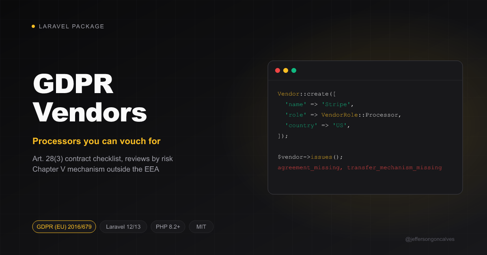

# Laravel GDPR Vendors



[](https://packagist.org/packages/jeffersongoncalves/laravel-gdpr-vendors)
[](https://github.com/jeffersongoncalves/laravel-gdpr-vendors/actions/workflows/tests.yml)
[](https://packagist.org/packages/jeffersongoncalves/laravel-gdpr-vendors)

A register of the third parties you share personal data with, for the EU General Data Protection Regulation (GDPR). It is part of the [laravel-gdpr](https://github.com/jeffersongoncalves/laravel-gdpr) suite.

A controller may only use processors that provide sufficient guarantees, under a contract that covers the points of Art. 28(3). For each vendor you record:

- its **role**: processor, independent controller or joint controller;
- a **risk tier**, which sets how often the vendor must be reviewed;
- the **data processing agreement** (DPA): when it was signed and when it expires, plus a checklist of what Art. 28(3) says it must cover;
- where the vendor is, and the **Chapter V transfer mechanism** when it is outside the EEA;
- when the relationship **ended**, and whether the data was deleted or returned (Art. 28(3)(g)).

Each vendor then tells you what it still owes.

> This package gives you tooling. It does not make you compliant on its own. Your agreements need legal review.

## Installation

```bash
composer require jeffersongoncalves/laravel-gdpr-vendors
php artisan vendor:publish --tag="gdpr-vendors-migrations"
php artisan migrate
php artisan vendor:publish --tag="gdpr-vendors-config"   # optional: checklist, review intervals, EEA list
```

## Usage

```php
use JeffersonGoncalves\GdprVendors\Enums\{TransferMechanism, VendorRisk, VendorRole};
use JeffersonGoncalves\GdprVendors\Models\Vendor;

$stripe = Vendor::create([
    'name' => 'Stripe',
    'role' => VendorRole::Processor,
    'services' => 'Card payments',
    'data_categories' => ['name', 'email', 'card data'],
    'country' => 'US',
    'transfer_mechanism' => TransferMechanism::StandardClauses,
    'risk' => VendorRisk::High,
    'dpa_signed_at' => '2026-01-10',
    'dpa_checklist' => ['instructions' => true, 'security_measures' => true /* ... */],
]);

$stripe->issues();           // [VendorIssue::AgreementIncomplete, ...]
$stripe->missingChecklistItems(); // ['sub_processors', 'audits', ...]
$stripe->nextReviewAt();     // reviewed_at (or created_at) + review_every[risk]
$stripe->markReviewed();

$stripe->terminate();        // contract ended
$stripe->confirmDataReturned();
```

### Issues

| Issue | When |
|---|---|
| `agreement_missing` | a processor or joint controller has no signed DPA |
| `agreement_expired` | `dpa_expires_at` has passed |
| `agreement_incomplete` | the DPA misses an item of `dpa_checklist` |
| `transfer_mechanism_missing` | `country` is outside the EEA (`eea` in the config) and there is no `transfer_mechanism` |
| `review_due` | the last review is older than `review_every` for its risk tier (high: 1 year, medium: 2, low: 3) |
| `data_return_pending` | the vendor was terminated and the data deletion or return is not confirmed |

An independent controller (a tax authority, a bank that receives a payment) needs no Art. 28 contract. After `terminate()`, only `data_return_pending` applies. The `active` scope skips terminated vendors.

The default checklist follows Art. 28(3): documented instructions, confidentiality, Art. 32 security, sub-processors, help with data subject requests, help with security, breaches, DPIAs and prior consultation, transfers outside the EEA, deletion or return at the end of the services, and audits. Change it in `config/gdpr-vendors.php`.

### Transfer mechanisms

`TransferMechanism` mirrors Chapter V: `adequacy` (Art. 45, e.g. the EU-US Data Privacy Framework), `standard_clauses` (Art. 46(2)(c)), `binding_corporate_rules` (Art. 47), `codes_certification` (Art. 46(2)(e) and (f)), `ad_hoc_clauses` (Art. 46(3)(a)), `administrative_arrangements` (Art. 46(3)(b)) and `derogation` (Art. 49).

## Report

```bash
php artisan gdpr:vendors             # every vendor, its next review and its issues
php artisan gdpr:vendors --issues    # only those with issues
php artisan gdpr:vendors --json
```

## Testing

```bash
composer test
```

## Changelog

See [CHANGELOG](CHANGELOG.md).

## License

The MIT License (MIT). See [License File](LICENSE.md).
